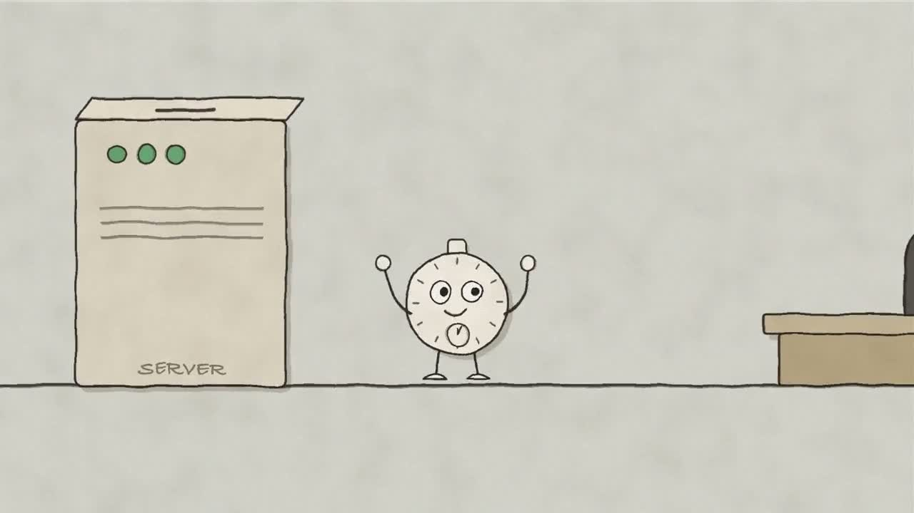
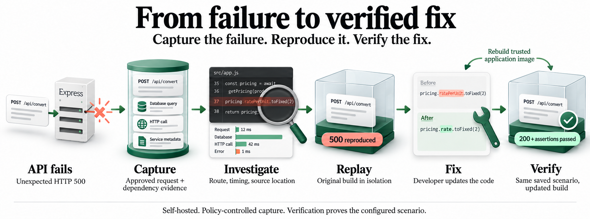

<div align="center">


# TimeMachine

[](https://github.com/Jago-Intelligence/TImemachine/blob/main/docs/media/timemachine-short-film.mp4)

[Watch the product film · 45 seconds](https://github.com/Jago-Intelligence/TImemachine/blob/main/docs/media/timemachine-short-film.mp4)

### Capture the failure. Reproduce it. Verify the fix.

Open-source, self-hosted failure investigation and isolated replay for Express backends.

[](LICENSE)
[](#supported-today)
[](#status)

[Get started](#getting-started) · [How it works](#how-it-works) · [Replay](#reproduce-and-verify) · [Documentation](#documentation) · [Contribute](CONTRIBUTING.md)

</div>

---

When a production API fails, the logs show an error, but reproducing it means finding
the request, following its dependency calls and rebuilding the conditions behind it.

TimeMachine puts that evidence in one place: the failed route, timing, request
correlation, source locations and the dependency results you approved for recording.
You can then replay a supported scenario in isolation and run your updated build
against it to check the response and business behavior.

Everything runs on your own infrastructure. There is no cloud account and no AI
provider to set up.



[View the full-size workflow](docs/media/timemachine-workflow.png)

## Status

**TimeMachine is in active development and has no public npm release yet.**
`@timemachine/sdk-node` and `@timemachine/replay` are private workspace packages.
The SDK, setup CLI, collector, dashboard and replay are all in this repository, and you
can build and try them from source. Package commands that use `npm install` describe
the intended release workflow and will not work against the public npm registry today.
See [package availability](docs/integrations/README.md#availability) and the
[development guide](docs/development.md) for source operation.

## What it does

- **Finds the failing request.** Shows the HTTP method, route, status, UTC error time,
  elapsed time, request ID and available project stack locations.
- **Groups repeated failures.** Related occurrences are grouped into issues, and each
  occurrence has its own execution timeline.
- **Records dependency evidence you approve.** Select request fields, supported HTTP-client
  responses and database results in a recording policy.
- **Explains supported causes.** Connects captured source access to a missing HTTP
  response field or database column. It shows the evidence and leaves code changes to you.
- **Replays in isolation.** Runs a trusted application image with recorded responses or
  reviewed synthetic PostgreSQL fixtures, with no production access.
- **Keeps your team informed.** Slack, email, Teams, Discord and webhook alerts for new
  or reopened issues, with settings managed in the dashboard.
- **Controls workspace access.** Individual accounts, admin/developer roles, assigned
  service projects and revocable project ingestion tokens.
- **Preserves replay history.** Historical build registrations, retention reporting,
  and optional private-registry backup with exact-image recovery.
- **Verifies more than a status code.** Checks your intended response, business
  assertions and, for synthetic database scenarios, committed rows or rollback.

## Getting started

**Pre-release:** packages are currently private workspace packages. Start with the
[source installation guide](docs/integrations/README.md), then follow
[Express integration](docs/express-setup.md). The commands below apply once the
packages have been built and installed in your application.

## How it works

| Part                         | Role                                                                           |
| ---------------------------- | ------------------------------------------------------------------------------ |
| `@timemachine/sdk-node`      | Captures failures from your Node.js app and sends them to your collector       |
| Collector (`apps/collector`) | Authenticated API that validates and stores incidents                          |
| Storage (`packages/storage`) | Durable PostgreSQL incident storage, plus a temporary in-memory adapter        |
| Dashboard (`apps/dashboard`) | Issues list, occurrence timelines, cause explanations, replay and verification |
| `@timemachine/replay`        | Registers trusted Docker images and runs sandboxed replays                     |

The dashboard talks to the collector API and never connects to PostgreSQL directly.
See [architecture](docs/architecture.md) for details.

## Add it to your Express app

Once the packages are available to your project:

```sh
npx timemachine init --service my-api --entry server.js
```

Setup creates a recording policy, startup configuration, a private environment
template and a replay runner template. It preserves your existing files and refuses to
overwrite an existing configuration directory.

Configure your backend in `timemachine/config.json`:

```json
{
  "version": 1,
  "collectorUrl": "https://collector.company.com",
  "service": { "name": "my-api", "version": "1.0.0", "environment": "production" },
  "credentialsFile": "timemachine/credentials.json",
  "recordingPolicy": "timemachine/recording-policy.json",
  "replayRegistry": ".timemachine/replay-apps.json"
}
```

Put the project ingestion token from **Dashboard → Workspace → Tokens** in the
private, git-ignored `timemachine/credentials.json`. Public configuration and
credentials stay separate. No application `.env` edits are required.

Then check the setup and start recording:

```sh
npx timemachine doctor   # checks configuration, collector, auth and replay registration
npx timemachine record   # starts your entrypoint with recording enabled
```

Unexpected request failures are captured automatically, so you don't need a capture call
in every route. Successful requests and ordinary 4xx responses, such as a wrong password
returning 401, are ignored by default. Use one recording integration per application to
avoid duplicate captures.

Other ways to run it:

```sh
npx timemachine dev                                   # Node watch mode for development
npx timemachine script                                # adds an npm script, keeps your existing ones
node --import=@timemachine/sdk-node/automatic dist/server.js   # production startup
```

For failures outside observed requests, call `captureException` from
`createTimeMachine(...)`. See the [Express setup guide](docs/express-setup.md) and the
[JavaScript](docs/integrations/javascript.md) and [TypeScript](docs/integrations/typescript.md)
guides.

## Reproduce and verify

Capture works out of the box. Replay needs a little more setup: approved inputs, a
configured app factory, meaningful assertions and a registered, trusted Docker image.
It isn't enabled for every incident automatically.

1. **Approve the evidence** in the recording policy. Partial recordings still work for
   investigation.
2. **Register an application scenario.** Create your Express app without starting a
   production server, inject controlled dependencies and declare the intended response.
3. **Build and register the image:**
   `npx timemachine replay build` builds the approved source files, registers the image,
   and updates your recorder configuration.
4. **Replay the captured build** from the occurrence page in the dashboard.
5. **Verify your fix** by rebuilding and registering the updated image, then verifying
   the same occurrence against the current build.

| Replay mode           | What the sandbox uses                                                         | What it can establish                                      |
| --------------------- | ----------------------------------------------------------------------------- | ---------------------------------------------------------- |
| Recorded dependencies | Approved request fields, recorded HTTP responses and PostgreSQL read results  | Behavior against the saved inputs and dependency results   |
| Synthetic PostgreSQL  | Approved request fields and a fresh database from reviewed synthetic fixtures | Declared response, committed data and transaction rollback |

Replay containers have no network access, production credentials or host mounts, and
their resources are bounded. A passing verification confirms the configured scenario
only. It doesn't prove every request is fixed or resolve the grouped issue.

## Supported today

| Area                               | Scope                                                                                            |
| ---------------------------------- | ------------------------------------------------------------------------------------------------ |
| Language                           | JavaScript and TypeScript on Node.js 24                                                          |
| Express                            | Express 5 automatic failure capture with available error source locations                        |
| Native Node.js HTTP                | Explicit handler wrapping and failure capture                                                    |
| HTTP dependencies                  | Native `fetch` and Axios; approved bounded recording and replay                                  |
| Other dependency adapters          | Selected mysql2, MongoDB and BullMQ operations; see [adapter scope](docs/dependency-adapters.md) |
| PostgreSQL reads                   | `pg` 8 promise-based calls; approved bounded `SELECT` patterns                                   |
| PostgreSQL writes and transactions | Opt-in synthetic-fixture replay                                                                  |
| Incident storage                   | Durable PostgreSQL adapter; temporary in-memory adapter for development                          |

Other frameworks can use explicit capture. There are no SDKs for other backend
languages, arbitrary ORMs or streaming protocols yet.

## Alerts that reach your team


New and reopened issues notify your configured channels. Repeated failures in an open
issue stay grouped. Each destination has independent delivery and retries; email uses
SMTP, while chat integrations and custom endpoints use webhooks.

[Configure alert channels](docs/alerts.md) · [Open the full-size illustration](docs/media/timemachine-alerts.png)

## Privacy and deployment

Capture starts with metadata. Request bodies and dependency results are stored only for
fields you explicitly approve. Raw credentials, headers and unrestricted database
results are not retained. Omitted or unsupported data limits replay.

Use HTTPS for remote ingestion, a private auth token and durable PostgreSQL storage, and
keep the dashboard's collector credentials server-side. Review retention, resource
limits and the [security policy](SECURITY.md) before deploying. Evaluate this
pre-release against your own production requirements first.

## Documentation

[Browse all guides](docs/README.md).

- [Installation and availability](docs/integrations/README.md)
- [Express setup](docs/express-setup.md)
- [Collector configuration](docs/collector.md)
- [Durable incident storage](docs/storage.md)
- [Dashboard](docs/dashboard.md)
- [Workspace users, roles and project tokens](docs/workspace-access.md)
- [Self-hosted workspace setup](docs/self-hosted-setup.md)
- [Backend project configuration](docs/project-configuration.md)
- [Issue alerts: Slack, email, Teams, Discord and webhooks](docs/alerts.md)
- [Replay](docs/replay.md)
- [Self-hosting](docs/self-hosting.md)
- [Architecture](docs/architecture.md)
- [Roadmap](docs/roadmap.md)

## Contributing

Bug reports and focused contributions are welcome. Read the
[contribution guide](CONTRIBUTING.md) and the [development guide](docs/development.md).
Run `pnpm check` before opening a pull request. Report vulnerabilities through the
[security policy](SECURITY.md).

Licensed under [Apache 2.0](LICENSE).

## Maintainer

Maintained by [Sujan Pokhrel (@PokhrelSujan96)](https://github.com/PokhrelSujan96).
