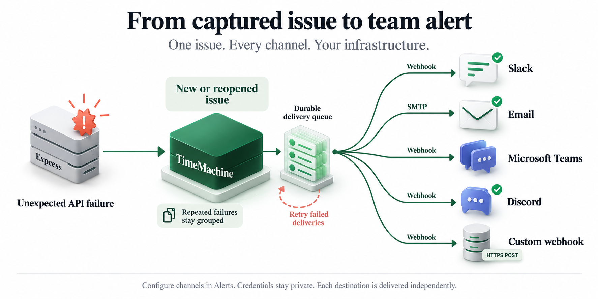

# Issue alerts



## Dashboard alert settings

Open **Alerts** in the dashboard to enable channels, enter credentials, save settings and send a test. Saved settings override environment configuration and take effect without a restart (other collector processes reload within five seconds). Save before testing; clicking Send test sends a real notification.

For a repository installation, run `pnpm setup:notifications`, apply migrations with `pnpm db:migrate`, then restart the collector. For a packaged/self-hosted collector, apply its migrations and set `NOTIFICATION_ENCRYPTION_KEY` to a cryptographically random 32-byte key encoded as 64 hexadecimal characters. Keep this key on the collector, outside the database. The encryption key belongs to collector infrastructure, not SDK project credentials.

Credentials are encrypted together with AES-256-GCM before storage and are never returned by the settings API. Back up the encryption key alongside the database: losing or changing it makes saved settings unreadable and prevents collector startup until restored. This version does not support key rotation. PostgreSQL persists settings; memory storage loses them on restart. Disabling a channel pauses delivery while retaining its encrypted credentials. Empty credential inputs preserve existing credentials.

The dashboard uses its existing signed-in workspace session and origin checks for changes and tests. The collector endpoints require its bearer token. In account mode, only administrators can view, change or test notification settings; developers are rejected by both dashboard and collector APIs. Legacy mode retains the shared workspace login. HTTP 2xx from a test means provider acceptance, not guaranteed inbox/channel delivery. Teams may accept a workflow trigger before posting its card.

Developers only need SDK connection/recording configuration in their Express app. Notification credentials live on the collector, not in the application SDK. The existing environment-based setup below remains supported until dashboard settings are saved.

The collector can send alerts to a generic webhook, a Slack incoming webhook, SMTP email, Microsoft Teams, or Discord. Choose one destination per channel, or enable several channels together. Webhook/Slack alerts require `ALERT_WEBHOOK_URL`; email requires the SMTP settings below.

Alerts fire when a grouped issue is first created, and when a new occurrence reopens a resolved issue. More occurrences in an already-open issue, duplicate SDK deliveries, successful requests and excluded client errors do not create alerts. Existing open issues are not retroactively announced when you enable alerts.

## Webhook setup

With PostgreSQL storage, apply the new outbox migration before restarting the collector:

```bash
pnpm db:migrate
```

Add settings to your private `.env`:

```dotenv
ALERT_CHANNEL=webhook
ALERT_WEBHOOK_URL=https://your-receiver.example/timemachine-alerts
ALERT_WEBHOOK_SECRET=replace-with-a-random-secret-of-at-least-32-characters
ALERT_DASHBOARD_ORIGIN=https://timemachine.your-company.example
```

Use `openssl rand -hex 32` to generate the signing secret. Restart the collector to apply settings. Production requires HTTPS for the receiver and dashboard. A receiver URL is an administrator-controlled secret; it is never taken from incident data or returned by the status API. Redirects are rejected.

Each POST contains version, opaque event ID, issue revision, event type (`issue.created` or `issue.reopened`), issue/incident IDs, error occurrence time, service name/environment, error code, method, route template and dashboard issue URL. It excludes request bodies, dependency responses, database rows, stack traces, raw error messages and user identities.

The receiver should promptly return a 2xx response. Headers:

- `X-TimeMachine-Event-Id`: stable delivery event ID, including on retries.
- `X-TimeMachine-Timestamp`: Unix seconds when this delivery was sent.
- `X-TimeMachine-Signature`: `sha256=<hex>` when a webhook signing secret is configured.

Verify the signature using HMAC-SHA256 over `<timestamp>.<raw-body>` with the configured secret. Compare signatures in constant time, reject timestamps outside your chosen freshness window (for example five minutes), and deduplicate event IDs. Do not reserialize the parsed JSON before signature verification.

## Slack setup

Create a Slack app, enable Incoming Webhooks and add a webhook to the intended channel, following [Slack's setup guide](https://docs.slack.dev/messaging/sending-messages-using-incoming-webhooks). Save its URL privately:

```dotenv
ALERT_CHANNEL=slack
ALERT_WEBHOOK_URL=https://hooks.slack.com/services/YOUR/WEBHOOK/PATH
ALERT_DASHBOARD_ORIGIN=https://timemachine.your-company.example
```

Restart the collector. Notifications use a prominent heading, separate service/environment/API/error fields, viewer-local Slack timestamps and an Investigate in TimeMachine button. Values are escaped and placed in code spans; notification previews include a readable UTC timestamp. Slack mode does not use the generic webhook HMAC header. No workspace-wide mentions are generated. Multiple channels can be enabled with `ALERT_CHANNELS`.

## Email setup

Add your provider's SMTP settings to the collector's private `.env`:

```dotenv
ALERT_CHANNEL=email
SMTP_HOST=smtp.your-provider.example
SMTP_PORT=587
SMTP_SECURE=false
SMTP_USER=your-smtp-user
SMTP_PASSWORD=your-smtp-password
ALERT_EMAIL_FROM=alerts@your-company.example
ALERT_EMAIL_TO=developers@your-company.example
ALERT_DASHBOARD_ORIGIN=https://timemachine.your-company.example
```

Restart the collector. Port 587 normally uses STARTTLS (`SMTP_SECURE=false`); port 465 normally uses immediate TLS (`SMTP_SECURE=true`). Remote servers require a valid TLS certificate. Plain SMTP is allowed only on loopback in development/test. Credentials must be supplied together; a local SMTP inbox tool may omit both. Use a single recipient, or a team distribution address, and a provider-approved sender.

Email includes an HTML card and plain-text alternative with the same limited metadata as webhook alerts. The issue link opens the dashboard. Retries retain a stable Message-ID but can still duplicate. SMTP acceptance means the provider accepted the message, not that it reached the inbox. The existing queue, retries and deadline apply. Email mode ignores the webhook URL; only the selected channel receives alerts.

For local testing, use `SMTP_HOST=127.0.0.1`, your SMTP inbox tool's port and `SMTP_SECURE=false` without credentials. SMTP configuration follows [Nodemailer's documentation](https://nodemailer.com/smtp).

## Microsoft Teams setup

Create a Teams **Workflows** incoming webhook that posts an Adaptive Card to your chosen channel. Use the trigger **When a Teams webhook request is received** with authentication set to **Anyone**: this collector uses the secret webhook URL rather than Microsoft OAuth. Follow [Microsoft's setup guide](https://support.microsoft.com/en-us/workflows/send-messages-in-teams-using-incoming-webhooks). Save the entire URL, including its query parameters:

```dotenv
ALERT_CHANNEL=teams
ALERT_WEBHOOK_URL=https://your-teams-workflow-webhook-url
ALERT_DASHBOARD_ORIGIN=https://timemachine.your-company.example
```

Restart the collector. Messages include an Adaptive Card with service, environment, API route, error, UTC timestamp and an Investigate button. Use a workflow that accepts the standard `message` / `attachments` Adaptive Card envelope. A 2xx response confirms webhook acceptance; check workflow run history if the card does not appear. Workflows belong to users, so assign a co-owner to avoid losing notifications when an owner leaves. OAuth-protected workflows are not supported by this adapter.

## Discord setup

Create a webhook in your channel's **Edit Channel → Integrations → Webhooks** settings and copy its URL. See [Discord's webhook guide](https://discord.com/safety/using-webhooks-and-embeds).

```dotenv
ALERT_CHANNEL=discord
ALERT_WEBHOOK_URL=https://discord.com/api/webhooks/YOUR_ID/YOUR_TOKEN
ALERT_DASHBOARD_ORIGIN=https://timemachine.your-company.example
```

Restart the collector. Alerts use a colored embed with the issue title as a clickable dashboard link, separate metadata fields and an occurrence timestamp. Mentions are disabled. Delivery requests use `wait=true` for server confirmation. For forum/media channels, add the existing thread's `thread_id` query parameter to the webhook URL. Rate limits and other non-2xx responses use the existing bounded retries.

Single-channel mode selects one destination; multi-channel mode is described below. Existing settings for other channels can remain in `.env`. Both adapters send only approved alert metadata and use the same new/reopened issue rules and durable queue as Slack. Webhook URLs are secrets. No external notifications are sent during local mock tests.

## Enable several channels together

`ALERT_CHANNELS` overrides `ALERT_CHANNEL`. Each named channel requires its own destination:

```dotenv
ALERT_CHANNELS=slack,email,teams,discord
ALERT_SLACK_URL=https://hooks.slack.com/services/YOUR/WEBHOOK/PATH
ALERT_TEAMS_URL=https://your-complete-teams-workflow-url
ALERT_DISCORD_URL=https://discord.com/api/webhooks/YOUR_ID/YOUR_TOKEN
SMTP_HOST=smtp.your-provider.example
SMTP_PORT=587
SMTP_SECURE=false
SMTP_USER=your-smtp-user
SMTP_PASSWORD=your-smtp-password
ALERT_EMAIL_FROM=alerts@your-company.example
ALERT_EMAIL_TO=developers@your-company.example
ALERT_DASHBOARD_ORIGIN=https://timemachine.your-company.example
```

To include a custom webhook, add `webhook` to the list and configure `ALERT_WEBHOOK_URL` and optionally `ALERT_WEBHOOK_SECRET`. Existing single-channel settings still work when `ALERT_CHANNELS` is absent. Missing destinations and duplicate/unknown channel names fail startup with field names only.

New/reopened issues create one durable delivery record per selected channel atomically with incident storage. Each channel has separate attempts, leases and acknowledgement: a failed service does not re-send a successful service. Delivery is asynchronous and processed one destination at a time with a bounded deadline. All channel copies share the event ID. PostgreSQL preserves pending records across restarts; no new database migration is needed. Disabling a channel pauses its pending records until re-enabled or expired. Legacy queued records without a channel use the current first selected channel. Changing a channel's URL redirects its pending deliveries to the new destination; adding a channel does not retroactively announce existing issues.

`GET /v1/alerts/status` includes the selected `channels`; pending/failed counts count channel deliveries rather than distinct issues. Delivery logs include channel names. These retries remain at least once, so provider acceptance followed by a crash can still duplicate that channel's notification.

## Validate delivery

Save channels in Dashboard → Alerts, then use the selected channel's test button.
Tests send a real message; use a staging destination first. Trigger a new issue or reopen
an explicitly resolved issue to validate end-to-end delivery. Repeated failures while
an issue remains open should add occurrences without creating another issue alert.

For custom receivers, validate the documented signature and handle repeated event IDs
idempotently. The repository's local receiver is a development helper, not a production
signature validator. Provider credentials remain on workspace infrastructure.

## Delivery guarantees and status

PostgreSQL stores an event in the same transaction as the new occurrence and issue lifecycle update. Concurrent collectors lease pending events, so a single event is not normally delivered by two workers. Pending deliveries survive restarts. Memory storage is temporary, including its alert queue, and shares the existing memory limits.

The worker sends asynchronously, with a five-second request deadline and up to five delivery claims. Failures retry after approximately 1, 5, 30 and 120 seconds, plus polling delay. A crashed worker's lease is reclaimable after 15 seconds. Each claim counts toward the attempt limit. Successful events are removed; exhausted events remain visible in failed counts. PostgreSQL queue records expire after seven days or the configured incident retention, whichever is shorter; memory queue records use incident retention. Disabling alerts pauses pending deliveries; re-enabling sends unexpired queued events to the currently configured destination.

Delivery is at least once within these retry/retention limits, not exactly once: a receiver may accept a message before the collector crashes or loses the response. Deduplicate event IDs in custom receivers. Slack can show duplicates in this recovery case. There is no manual redelivery UI yet.

The authenticated `GET /v1/alerts/status` endpoint reports:

```json
{ "enabled": true, "channels": ["slack", "email"], "pending": 0, "failed": 0 }
```

Delivery logs contain event ID, attempt and delivered/retry/failed status. They never include receiver URLs, signing secrets, response bodies or payloads. A receiver outage does not wait inside ingestion HTTP handling; a storage failure still fails the atomic incident transaction. This first version has no incident-volume threshold, per-service subscription settings or resolution notification.
