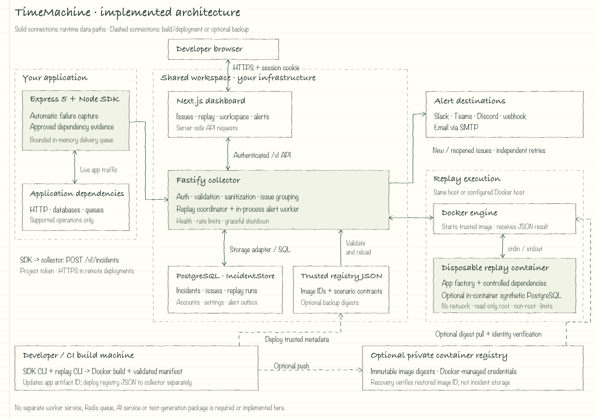

# Architecture

This document describes the **implemented TimeMachine architecture**, not a target
roadmap. There are two service applications: a Fastify collector and a Next.js dashboard.
The Node SDK runs inside the user's backend. Replay execution uses Docker, while alert
processing runs inside the collector.

[Open the full-size sketch](media/timemachine-architecture-sketch.png) ·
[Editable architecture source](media/timemachine-architecture.svg).
Solid arrows represent runtime traffic. Dashed arrows represent build/deployment paths
or optional registry backup. Boxes are logical boundaries, not a requirement to use
separate physical machines.

## Running components

| Component               | Implementation                       | Responsibility                                                                                                               |
| ----------------------- | ------------------------------------ | ---------------------------------------------------------------------------------------------------------------------------- |
| Application SDK         | `packages/sdk-node`                  | Express 5 automatic capture, explicit capture, approved dependency recording, bounded delivery, setup/startup CLI            |
| Collector               | `apps/collector`                     | Authenticated `/v1` API, validation, sanitization, storage, issue lifecycle, replay coordination and alert delivery          |
| Dashboard               | `apps/dashboard`                     | Browser-facing Next.js app with server-side collector requests, signed session cookies, investigation and workspace settings |
| Storage adapter         | `packages/storage`                   | `IncidentStore` interface, PostgreSQL implementation with Drizzle/migrations, and bounded in-memory implementation           |
| Replay library / CLI    | `packages/replay`                    | App-factory scenarios, registry validation, Docker execution, build/registration and optional backup/recovery                |
| Contracts               | `packages/core`                      | Zod incident, recording, replay and operation schemas; capability checks and evidence-based cause logic                      |
| Configuration / logging | `packages/config`, `packages/logger` | Validated settings and controlled structured logs                                                                            |

The standalone CLI bins live in SDK/replay packages. There is no `packages/cli`,
`apps/worker`, `packages/ai` or `packages/test-generation` implementation. The platform
alert queue is a PostgreSQL outbox, **not Redis or BullMQ**. BullMQ support refers to
recording selected operations of a user's queue dependency.

## Capture and storage path

1. The SDK instruments a user's Express application before it loads and observes
   unexpected request failures. Explicit capture handles errors outside observed requests.
2. Approved request fields and supported dependency results join metadata, timing,
   source locations and the execution timeline. Successful requests and ordinary 4xx
   responses do not become incidents by default.
3. A bounded **in-memory SDK queue** sends authenticated `POST /v1/incidents` requests.
   This queue is separate from durable alert delivery. It can lose captures after a
   crash, overload or prolonged collector outage.
4. The collector authenticates, validates the bounded schema and sanitizes captures
   before storing them through `IncidentStore`. Storage preserves ingestion idempotency,
   groups retained occurrences into issues and records applicable alert events.

PostgreSQL is the durable platform-storage adapter. Its schema stores incidents,
issue-resolution evidence, replay runs, workspace users/projects/tokens/sessions,
encrypted notification settings and the alert outbox. The memory adapter is temporary
and loses its contents on restart. Other databases supported as **recorded application
dependencies** are not platform incident-storage adapters.

The provided infrastructure Compose file starts PostgreSQL 17 with a named volume;
it does not deploy the collector or dashboard as a production platform stack.
Workspace deployment must provide those services separately.

## Dashboard, authentication and project access

The browser talks to the dashboard. Next.js server components and API routes talk to
the collector; the dashboard never connects directly to PostgreSQL. Credential-bearing
collector calls remain server-side. Mutating dashboard routes perform origin checks.

Account mode provides individual users, admin/developer roles and service-bound
projects. The dashboard uses a signed HttpOnly cookie containing a workspace-session
reference, and the collector resolves its persisted session and current access rights.
Developers see incidents and issues in assigned projects. Administrators manage users,
projects, tokens and alerts. Legacy shared-password mode remains available.

Project ingestion tokens permit ingestion for their own service and limited readiness
checks. They do not grant dashboard, incident-reading or workspace-administration
access. Passwords and tokens are stored as hashes; notification provider secrets are
stored encrypted with an infrastructure-managed encryption key. These are different
credential types, with different scopes.

A shared workspace can be reached by developers on different networks. Collector and
dashboard URLs are distinct. Remote deployments need HTTPS and appropriate routing;
TLS termination/reverse proxies are deployment infrastructure, not built-in services.

## Replay control and execution

The collector's replay coordinator reads saved incidents and fixtures through storage,
checks bindings and trusted artifacts, selects the captured or current build, starts
execution and persists replay observations and verification results.

It invokes the Docker CLI through `packages/replay`. Docker creates a disposable
container outside the collector process; there is **no separate replay worker service**.
The collector needs trusted access to its configured Docker daemon. A remote daemon
can be configured through Docker settings; this is not a job scheduler or worker RPC.

Containers run a developer-supplied app factory and scenario assertions. Replay uses
supported recorded HTTP/database/queue results or reviewed synthetic dependencies.
Synthetic PostgreSQL replay starts a fresh PostgreSQL process inside the replay
container; it does not connect to the platform's incident-storage database or a
production application database.

The sandbox has no external network, no host mounts, a read-only root filesystem,
a bounded writable `/tmp`, a non-root UID, dropped capabilities and resource/time limits.
Input and observations travel through stdin/stdout. The container does not receive
production application credentials. Docker isolation alone is not a sufficient
security boundary for arbitrary hostile multi-tenant code.

A successful verification checks the configured scenario and assertions. It does not
prove every request is fixed, modify application code or automatically resolve an issue.

## Build identity, registration and backup

A developer or CI build machine runs `timemachine replay build`. It copies approved
application files into a temporary Docker build context, builds an image, validates its
scenario manifest and registers its immutable Docker image ID. It then updates the
application's recorder artifact ID. A capture references the build that handled it.

The trusted registry is a **JSON file**, configured with `REPLAY_APPS_FILE` on the
collector. It contains service registrations, captured/current image IDs and scenario
contracts. Valid file changes reload on incoming requests; malformed changes keep the
last valid registration. Changing the configured path requires a restart.

Building on another machine does not deploy that JSON file to the collector. The image
and metadata must reach its replay host through the deployment process. Historical
registrations remain until explicitly managed; registration fails at capacity rather
than silently dropping old builds.

**Optional private container registry:** a configured `backupRepository` lets the build
command push an image and record its immutable repository digest. Docker manages push
and pull credentials. If the replay host lacks a registered image, it can pull that
configured digest and must verify the restored image ID against the captured artifact.
Recovery status is surfaced in the dashboard. This image registry is separate from the
trusted JSON registry and PostgreSQL storage.

Current builds and builds referenced by retained captures appear protected in the
read-only retention report. TimeMachine does not delete Docker images or remote backups
automatically. External pruning/garbage collection can still remove required images.

## Alerts and settings

New and reopened issues create independently deliverable events for selected channels.
Repeated captures of an already-open issue stay grouped rather than producing a new
issue alert each time.

The collector runs an **in-process alert worker**. Through storage it claims outbox
entries with leases, performs bounded provider delivery, and records success or retry
state. PostgreSQL makes the outbox durable; the collector process is the scheduler and
sender. Alert sending does not require a separate Redis queue.

Slack, Teams, Discord and custom webhooks use HTTP delivery. Email uses SMTP. Each
selected channel has independent delivery state and retry behavior. Settings saved
through the dashboard are encrypted in storage and refreshed by the running collector;
provider credentials are not returned to the browser. Infrastructure environment
settings remain a fallback until dashboard settings are saved.

## Boundaries and compatibility

- Core contracts contain no Node runtime, framework, database service or AI provider
  imports. The envelope is language-neutral; only a Node.js SDK is implemented today.
- SDK code depends on core and runtime utilities, not the platform storage package.
- Storage depends on core and implements the adapter interface; callers own its lifecycle.
- Collector composes storage, replay, configuration and logging.
- Dashboard uses core contracts and authenticated collector APIs.
- Application factories supplied for replay remain developer code, executed in the
  sandbox rather than imported into the collector.

Incident schema version, `/v1` API version, replay scenario versions and package
versions serve different purposes. Unknown fields and invalid versions are rejected
according to their schemas. Stored sanitized captures and derived replay observations
remain separate. Changes to contracts need coordinated compatibility checks and tests.

## Operational limits

Liveness and readiness are separate; readiness requires usable storage. Requests and
capture bodies are bounded, rate limits apply, and shutdown coordinates request
handling, alert-worker stop, replay cancellation and storage closure.

Cause explanations are evidence-based rules, not an AI service. The dashboard reports
missing evidence rather than inventing a root cause. No AI or cloud account is required
for the core workflow. SSO, MFA, multi-workspace tenancy and an independent replay-worker
fleet should not be inferred from the current project/role model.

See [collector](collector.md), [storage](storage.md), [workspace access](workspace-access.md),
[alerts](alerts.md), [replay](replay.md) and [self-hosted setup](self-hosted-setup.md)
for configuration and detailed limits.
